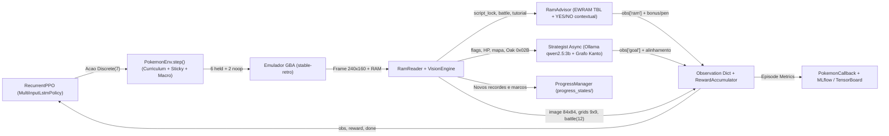

# Pokémon FireRed RL — Documentação Técnica

Projeto de **Aprendizado por Reforço Profundo Hierárquico (HRL)** para jogar **Pokémon FireRed (Game Boy Advance — USA v1.0)** usando `stable-retro`, `RecurrentPPO + LSTM`, leitura direta de memória RAM/EWRAM (Zero OCR), planejamento estratégico assíncrono com **LLM local via Ollama**, currículo dinâmico por *Event Flags* e rastreamento completo em **MLflow**.

---

## Visão Geral e Stack Tecnológica

| Componente | Tecnologia / Implementação | Papel no Sistema |
| :--- | :--- | :--- |
| **Emulação GBA** | `stable-retro` + `Gymnasium` | Executa a ROM `rom.gba` e expõe vídeo (`240×160×3`), botões GBA e buffer completo de RAM (`WRAM + IRAM`). |
| **Percepção RAM (Zero OCR)** | [src/reader.py](../src/reader.py) (`RamReader`) | Lê coordenadas reais, HP/níveis, insígnias, *Event Flags*, inventário XOR-criptografado, textos EWRAM e matriz `9×9` de colisão/warps/NPCs. |
| **Advisor Tático de Menus** | [src/advisor.py](../src/advisor.py) (`RamAdvisor`) + [src/vision.py](../src/vision.py) (`VisionEngine`) | Decodifica diálogos Gen 3 em microssegundos, classifica 7 situações de jogo, detecta congelamento em texto e fornece `YES/NO` contextual. |
| **Planejador Estratégico (HRL)** | [src/strategist.py](../src/strategist.py) (`Strategist`) | Roda em `ThreadPoolExecutor` assíncrono com **Ollama local (`qwen2.5:3b`)** + grafo de Kanto e guardrails anti-alucinação, emitindo embedding `goal` (`6` dims). |
| **Política Neural (General)** | `sb3-contrib` `RecurrentPPO` (`MultiInputLstmPolicy`) + `VecNormalize` | Combina CNN (`84×84×1`), extrator denso (`ram`, `collision_grid`, `visited_grid`, `goal`, `battle`) e LSTM para decidir entre 7 ações (`Discrete(7)`). |
| **Braço Robótico (Soldier)** | [src/env.py](../src/env.py) (`_run_potion_macro`, `_run_pokeball_macro`, `_run_mart_buy_macro`, `_run_tm_macro`) | Executa sequências fechadas em RAM (`cb2`, cursores, textos) quando a política dispara `TACTICAL_MACRO` em contextos válidos. |
| **Inteligência de Combate Gen 3** | [src/battle_data.py](../src/battle_data.py) | Tabela completa de tipos Gen 3, ~120+ golpes (`MOVES_DB`), cálculo de STAB/efetividade (`score_moves`) e suporte à captura. |
| **Currículo & Recompensas** | [src/progress.py](../src/progress.py) (`ProgressManager`, `EpisodeStats`) | Amostragem **Frontier Bias 50/30/20 + Genesis Anchor**, bônus monotônicos anti-farming e salvamento orgânico em `progress_states/`. |
| **Governança & Observabilidade** | [src/callbacks.py](../src/callbacks.py) + [src/mlflow_utils.py](../src/mlflow_utils.py) | Rastreamento contínuo em `sqlite:///mlflow.db`, versionamento no Model Registry (`@champion`, `@current`), logs TensorBoard e cirurgia automática ([src/surgery.py](../src/surgery.py)). |

---

## Fluxo de Execução por Step (`PokemonEnv`)



---

## Estrutura Atualizada do Repositório

```text
pkmn_fire_red/
├── docs/                           # Documentação técnica em Markdown
│   ├── index.md                    # Visão geral, stack, diagrama e índice
│   ├── architecture.md             # HRL, PPO+LSTM, Observation/Action Space, Cirurgia e Anti-Memorização
│   ├── ram_and_perception.md       # Endereços GBA, grids 9x9, RamAdvisor TBL e VisionEngine
│   ├── rewards_and_curriculum.md   # Funções de recompensa, Early Stopping e Frontier Bias 50/30/20
│   └── operations_and_mlflow.md    # Execução, avaliação, testes, MLflow Registry e troubleshooting
├── src/
│   ├── __init__.py                 # Marca pacote Python
│   ├── config.py                   # Config frozen (CFG), dimensões (RAM/GRID/GOAL/BATTLE) e ActionSpace
│   ├── battle_data.py              # Tabela de tipos Gen 3, MOVES_DB, type_multiplier e score_moves
│   ├── reader.py                   # IWRAM/EWRAM/SaveBlock1-2, gBattleMons, economia e collision_grid 9x9
│   ├── vision.py                   # Classificador CV leve de OVERWORLD, BATTLE, DIALOGUE e WHITEOUT
│   ├── advisor.py                  # Decodificador Gen 3 (0x02021D18), SIT_*, repeat penalty e YES/NO contextual
│   ├── strategist.py               # Planejador hierárquico async (Ollama qwen2.5:3b + Kanto graph + guardrails)
│   ├── progress.py                 # ProgressManager (50/30/20 + Genesis Anchor), EpisodeStats e RewardAccumulator
│   ├── env.py                      # PokemonEnv (Gymnasium): obs, rewards, macros, anti-memorização, saves limpos
│   ├── callbacks.py                # PokemonCallback (métricas/trends) e Trainer (SubprocVecEnv, LR, checkpoint)
│   ├── surgery.py                  # Cirurgia de pesos LSTM/Adam/VecNormalize para evolução sem wipe
│   └── mlflow_utils.py             # Padronização de experimentos, tags, runs órfãos e Model Registry
├── scripts/
│   ├── train.py                    # Entrada de treinamento com tratamento SIGTERM/SIGINT e MLflow
│   ├── evaluate_mlflow.py          # Avaliação determinística (currículo e --from-start) logada no MLflow
│   ├── enjoy.py                    # Visualizador em tempo real via Pygame no modo determinístico
│   ├── summary.py                  # Resumo CLI de experimentos e versões no Model Registry
│   ├── tune.py                     # Script auxiliar de sweep (Makefile target `tune`)
│   └── tune_gen6.py                # Script auxiliar de sweep Gen6
├── tests/                          # Suíte automatizada (pytest: 55 testes unitários)
│   ├── test_battle.py
│   ├── test_reader.py
│   ├── test_progress.py
│   ├── test_strategist.py
│   ├── test_surgery.py
│   └── test_mlflow_tracking.py
├── research/                       # Scripts de mineração de offsets e referência
├── tools/                          # Ferramentas auxiliares legadas e utilitários de save state
├── DESIGN_GUIDELINES.md            # Histórico de decisões e lições aprendidas do projeto
├── Makefile                        # Atalhos Poetry para train, test, eval, ui, enjoy, clean
└── pyproject.toml                  # Dependências e configuração do pytest

> **Armazenamento de runtime no disco `D:` (`/mnt/d/projects/pkmn_fire_red_saves/`):** `pokemon_lstm_model.zip`, `checkpoints/`, `progress_states/`, `steps_state.txt`, `pokemon_tensorboard/`, `pokemon_training.log`, `ollama.log`, `screenshots/`, `whiteout_frames/` e `mlflow/` (`mlflow.db` + `mlruns/`).
```

---

## Navegação da Documentação

1. **[Arquitetura, Rede Neural, HRL e Anti-Memorização](architecture.md)** — Detalha os três níveis hierárquicos (`Strategist`, `RecurrentPPO + LSTM`, `Soldier` macros), todas as dimensões do `observation_space`, cirurgia de pesos e os mecanismos contra *overfitting* do início do jogo.
2. **[Leitura de RAM, Mapas Locais e Percepção](ram_and_perception.md)** — Documenta cada endereço de IWRAM/EWRAM/SaveBlock do FireRed (USA v1.0), construção da `collision_grid` e `visited_grid`, decodificação TBL no `RamAdvisor` e o `VisionEngine`.
3. **[Sistema de Recompensas, Proteções e Currículo Dinâmico](rewards_and_curriculum.md)** — Explica todas as componentes de recompensa (`CFG`), mitigação de *reward hacking*, regras de *early stopping* e o algoritmo **Frontier Bias 50/30/20 + Genesis Anchor**.
4. **[Operação, Avaliação, Testes e MLflow](operations_and_mlflow.md)** — Guia prático de execução (`train`, `evaluate_mlflow`, `enjoy`, `summary`, `pytest`, MLflow UI), métricas monitoradas e solução de problemas comuns.
